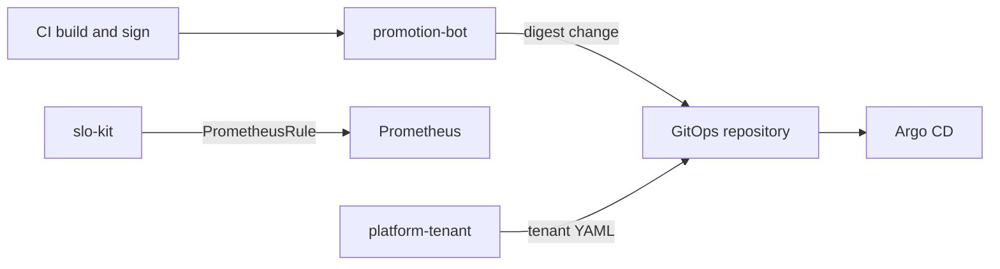

# platform-ops-python

Three small Python command-line tools for GitOps, SRE, and platform work.

They do **not** deploy anything. They check inputs and print (or write) YAML that Git and Argo CD would use later. The Boutique platforms already show Terraform, GitOps, and Kubernetes configuration on [EKS](https://github.com/btilki/boutique-eks-gitops), [AKS](https://github.com/btilki/boutique-aks-devsecops), and [GKE](https://github.com/btilki/boutique-gke-sre). This repository is the missing piece: **code** that keeps those platforms consistent.

Author: [Birol Tilki](https://www.linkedin.com/in/birol-tilki-48731326/)

| | |
| --- | --- |
| **Language** | Python 3.12+ |
| **Tools** | `promotion-bot`, `slo-kit`, `platform-tenant` |
| **Default** | Dry-run. Nothing on disk changes unless you pass `--write` |
| **Does not** | `kubectl apply`, create cloud networks, or replace Argo CD |
| **Check** | `make sync` → `make validate` → `make demo` |



| Command | Role it supports | What you give it | What you get |
| --- | --- | --- | --- |
| `promotion-bot` | DevOps | A GitOps values file and a `sha256:` digest | The same file with one digest updated. `:latest` is refused. |
| `slo-kit` | SRE | A short SLO YAML, or a measured success ratio | Prometheus burn-rate alerts, or remaining error budget |
| `platform-tenant` | Platform | A short tenant YAML | Namespace, quota, default-deny NetworkPolicy, Argo CD AppProject |

Similar tools already exist (Argo CD Image Updater, Renovate, Sloth, Crossplane). These three are smaller and explicit, so a reader can follow the code. Design notes are in [docs/adr](docs/adr).

---

## Install and run

You need Python 3.12 or newer and `make`.

```bash
git clone https://github.com/btilki/platform-ops-python.git
cd platform-ops-python
make sync          # creates .venv and installs the three commands
source .venv/bin/activate
make validate      # ruff, mypy, pytest
make demo          # runs all three tools in dry-run
```

`make sync` installs the package in editable mode, so the commands `promotion-bot`, `slo-kit`, and `platform-tenant` are on your `PATH` inside the virtualenv.

Dry-run is the default. `--write` updates a local file. `--open-pr` (promotion only) calls the GitHub API. Neither command talks to a Kubernetes cluster.

---

## 1. promotion-bot — change one image digest in Git

**Problem.** In [boutique-gke-sre](https://github.com/btilki/boutique-gke-sre), images are pinned by digest (`sha256:...`), not by a floating tag such as `:latest`. A GitHub Actions workflow currently does that pin with a short inline Python snippet. This tool is that snippet as a real program: CI may open a pull request; Argo CD is still the only thing that deploys.

**Input.** [`examples/gitops/values-images.yaml`](examples/gitops/values-images.yaml):

```yaml
images:
  frontend:
    repository: europe-west1-docker.pkg.dev/boutique-gke/boutique/frontend
    digest: sha256:50ca57c5...
```

**What the code does**, in `src/platform_ops/promotion/cli.py` (`promote`):

1. `normalize_digest` accepts only `sha256:` plus 64 hex characters. `:latest` is an error.
2. `assert_adjacent_promotion` allows only `dev → staging` or `staging → prod`. It refuses `dev → prod`.
3. The YAML is loaded with `ruamel.yaml`, so comments stay in the file. A dump that rewrites the whole file would make a noisy Git diff.
4. `update_service_digest` changes only `images.<service>.digest`.
5. If you pass a Trivy JSON report, fixable HIGH or CRITICAL findings stop the run.
6. It prints the new YAML. The file on disk stays unchanged unless you add `--write`.

Optional `--require-signature` runs `cosign verify`. Optional `--open-pr` opens a GitHub pull request. It needs `PROMOTION_GITHUB_TOKEN` (or a GitHub App token) and `--repo owner/name`. See [docs/runbooks/promotion-bot.md](docs/runbooks/promotion-bot.md).

**Try it.**

```bash
promotion-bot promote \
  --manifest examples/gitops/values-images.yaml \
  --service frontend \
  --digest sha256:aaaaaaaaaaaaaaaaaaaaaaaaaaaaaaaaaaaaaaaaaaaaaaaaaaaaaaaaaaaaaaaa \
  --from-env staging --to-env prod
```

Open the values file afterwards. The digest is still the old one. That is dry-run.

To refuse a bad promotion, change `--from-env` to `dev`. The command exits with an error because `dev → prod` skips staging.

**Read next.** `src/platform_ops/promotion/digest.py`, then `policy.py`, then `tests/promotion/test_promotion.py`.

---

## 2. slo-kit — SLO spec to alerts, and error budget

**Problem.** [boutique-gke-sre](https://github.com/btilki/boutique-gke-sre/blob/main/docs/sre/slos/catalog.md) defines browse at 99.9% and checkout at 99.95%, plus burn-rate alerts. Hand-written alert YAML drifts when every service copies it. This tool generates the Prometheus rules from a short spec, and it can say how much error budget is left.

**Input.** [`examples/slo/boutique.yaml`](examples/slo/boutique.yaml):

- `objective: 0.999` means 99.9%. The value `1.0` is rejected, because then the error budget is zero.
- `sli.good` and `sli.total` are PromQL selectors: good events over all events.

**`compile`** prints a `PrometheusRule`. For each SLO it writes a fast window and a slow window together (for example 5 minutes and 1 hour, at 14.4× burn). Both must be bad before the alert fires. That is the multi-window burn-rate pattern from the [Google SRE workbook](https://sre.google/workbook/alerting-on-slos/), the same idea as the GKE catalog (14.4×/1h, 6×/6h, 3×/1d, 1×/3d).

```bash
slo-kit compile --spec examples/slo/boutique.yaml --stdout
```

**`report`** does not query Prometheus. You pass the measured success ratio:

```bash
slo-kit report --sli 0.9992 --objective 0.999
```

`0.9992` means 99.92% of requests succeeded. The objective is 99.9%, so the allowed failure is 0.1%. The code computes how much of that allowance is already used, then prints a band. The bands match the [GKE error-budget policy](https://github.com/btilki/boutique-gke-sre/blob/main/docs/sre/error-budget-policy.md):

| Remaining budget | Band | Meaning |
| --- | --- | --- |
| more than 50% | `normal` | Ship as usual |
| 25–50% | `cautious` | Fewer risky changes |
| under 25% | `freeze` | Reliability work first |
| 0% | `sev2` | Budget exhausted |

**Read next.** `src/platform_ops/slo/budget.py` (the math), then `compile.py`, then `tests/slo/test_slo.py`.

---

## 3. platform-tenant — one short file, five Kubernetes objects

**Problem.** A team asks for a namespace. Writing Namespace, quota, limits, network policy, and an Argo CD project by hand drifts. This CLI renders those objects. It does not apply them. Git stays the source of truth.

**Input.** [`examples/tenant/payments.yaml`](examples/tenant/payments.yaml): name `payments`, team `checkout`, environment `staging`, a quota, and an Argo CD repository URL.

**What the code does:**

1. `load_tenant` checks the YAML. The name must be a DNS label (`payments`, not `Payments`).
2. `assert_not_reserved` refuses names such as `kube-system` and `argocd`. Exit code 3 means policy refused the name.
3. `render_tenant` prints five objects: Namespace, ResourceQuota, LimitRange, a default-deny NetworkPolicy (DNS to `kube-system` is the only egress), and an Argo CD `AppProject` limited to that namespace.
4. Without `--write`, it only prints.

```bash
platform-tenant apply --config examples/tenant/payments.yaml
```

`--write --out /tmp/payments` writes `/tmp/payments/tenant.yaml`. You would commit that file. You would not run `kubectl apply` from this tool.

**Read next.** `src/platform_ops/tenant/models.py`, then `render.py`, then `tests/tenant/test_tenant.py`.

---

## How the code is organized

```text
src/platform_ops/
  promotion/     promotion-bot
  slo/           slo-kit
  tenant/        platform-tenant
examples/        inputs you can run immediately
tests/           what must pass and what must fail
docs/adr/        why Python, why ruamel.yaml, why these burn windows
docs/runbooks/   what to check when a command exits non-zero
```

Each tool is a [Typer](https://typer.tiangolo.com/) CLI. YAML and numbers are checked with [Pydantic](https://docs.pydantic.dev/). Logs are JSON on stderr.

A useful reading order, one tool at a time:

1. Read the example YAML under `examples/`. That is the input.
2. Run the command in this README and look at the output.
3. Open the matching `cli.py` and follow the function.
4. Open the helper it calls (`digest.py`, `budget.py`, or `render.py`).
5. Open the test. The test is the specification.

`make validate` runs Ruff, mypy in strict mode, and pytest. Coverage is gated at 80%.

---

## Non-goals

- Recreating Terraform with boto3, the Azure SDK, or `gcloud`
- A web UI, a Django app, or a pandas dashboard
- A Kubernetes operator. A later controller could read the same tenant YAML. Hot-path controllers are a better fit for Go.
- Wrappers that only shell out to `kubectl` or Helm

---

## License

Apache License 2.0. See [LICENSE](LICENSE).
