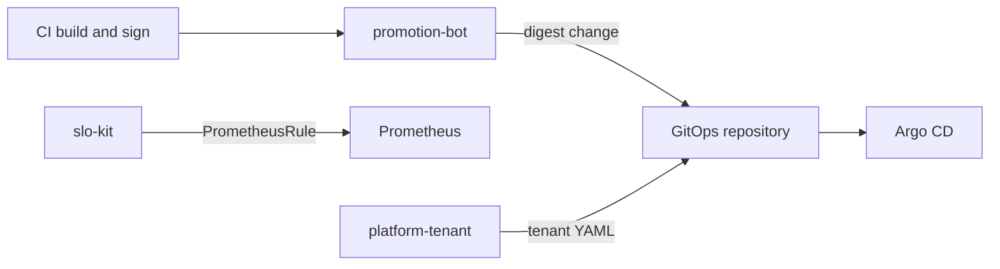
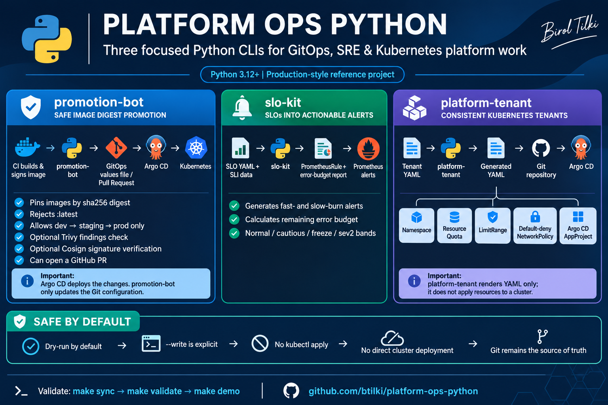

# platform-ops-python

[](https://www.python.org/)
[](https://github.com/btilki/platform-ops-python/actions/workflows/ci.yml)
[](LICENSE)
[](CHANGELOG.md)

Three small Python command-line tools for GitOps, SRE, and platform work.

They do **not** deploy anything. They check inputs and print (or write) YAML that Git and Argo CD would use later. The Boutique platforms already show Terraform, GitOps, and Kubernetes configuration on [EKS](https://github.com/btilki/boutique-eks-gitops), [AKS](https://github.com/btilki/boutique-aks-devsecops), and [GKE](https://github.com/btilki/boutique-gke-sre). This repository adds the Python CLIs that encode the same GitOps, SLO, and tenant rules those platforms describe.

Author: [Birol Tilki](https://www.linkedin.com/in/birol-tilki-48731326/)

| Aspect | Detail |
| --- | --- |
| Language | Python 3.12+ |
| Tools | `promotion-bot`, `slo-kit`, `platform-tenant` |
| Default | Dry-run. Nothing on disk changes unless you pass `--write` |
| Does not | `kubectl apply`, create cloud networks, or replace Argo CD |
| Check | `make sync` → `make validate` → `make demo` |



| Command | Role it supports | What you give it | What you get |
| --- | --- | --- | --- |
| `promotion-bot` | DevOps | A GitOps values file and a `sha256:` digest | The same file with one digest updated. `:latest` is refused. |
| `slo-kit` | SRE | A short SLO YAML, or a measured success ratio | Prometheus burn-rate alerts, or remaining error budget |
| `platform-tenant` | Platform | A short tenant YAML | Namespace, ResourceQuota, LimitRange, default-deny NetworkPolicy, Argo CD AppProject |

Similar tools already exist (Argo CD Image Updater, Renovate, Sloth, Crossplane). These three are smaller and explicit, so a reader can follow the code. Design notes and runbooks are in [docs](docs).

---

## Portfolio overview

The infographic below is **positioning only** (high-level pillars and Boutique cloud links). It does not deploy or sync clusters. Behaviour and commands for the three CLIs are in sections 1–3, [Non-goals](#non-goals), and [docs](docs).



Diagram catalog and how each visual pillar maps to real commands: [`assets/images/README.md`](assets/images/README.md).

---

## Install and run

You need Python 3.12 or newer and `make`.

```bash
git clone https://github.com/btilki/platform-ops-python.git
cd platform-ops-python
make sync          # creates .venv and installs the three commands
source .venv/bin/activate
make validate      # ruff check, ruff format --check, mypy, pytest
make demo          # runs all three tools in dry-run
```

`make sync` installs the package in editable mode, so the commands `promotion-bot`, `slo-kit`, and `platform-tenant` are on your `PATH` inside the virtualenv.

Dry-run is the default. `--write` updates a local file. `--open-pr` (promotion only) calls the GitHub API. None of the commands talk to a Kubernetes cluster.

Optional local hooks: `pre-commit install` uses [`.pre-commit-config.yaml`](.pre-commit-config.yaml) (Ruff, mypy, gitleaks). The Ruff hook revision matches `ruff==0.16.9` in `pyproject.toml`.

GitHub Actions ([`.github/workflows/ci.yml`](.github/workflows/ci.yml)) runs on push and pull request to `main`: `pip install -e ".[dev]"`, then the same Ruff, mypy, and pytest steps as `make validate`. You do not need pre-commit for CI to pass.

The [Dockerfile](Dockerfile) builds a slim image with all three commands installed. The default entrypoint is `promotion-bot`.

```bash
docker build -t platform-ops-python:local .
docker run --rm platform-ops-python:local promote --help
docker run --rm --entrypoint slo-kit platform-ops-python:local --help
docker run --rm --entrypoint platform-tenant platform-ops-python:local --help
```

Mount a workspace when you want local files on the path, for example:

```bash
docker run --rm -v "$PWD:/work" -w /work platform-ops-python:local \
  promote --manifest examples/gitops/values-images.yaml \
  --service frontend \
  --digest sha256:aaaaaaaaaaaaaaaaaaaaaaaaaaaaaaaaaaaaaaaaaaaaaaaaaaaaaaaaaaaaaaaa \
  --from-env staging --to-env prod
```

For `--open-pr`, set `PROMOTION_GITHUB_TOKEN`, and either pass `--repo owner/name` or set `PROMOTION_GITHUB_REPOSITORY`. Optional: `PROMOTION_GITHUB_API_URL` (defaults to `https://api.github.com`). Use `--path-in-repo` when the manifest path in Git differs from the local file path. See [`.env.example`](.env.example).

---

## 1. promotion-bot — change one image digest in Git

**Problem.** In [boutique-gke-sre](https://github.com/btilki/boutique-gke-sre), images are pinned by digest (`sha256:...`), not by a floating tag such as `:latest`. The [`manifest-digest-pr`](https://github.com/btilki/boutique-gke-sre/blob/main/.github/workflows/manifest-digest-pr.yml) workflow updates `values-images.yaml` with an inline Python block today. `promotion-bot` is that logic as a maintainable CLI (digest rules, Trivy gate, optional cosign, optional `--open-pr`). Argo CD is still the only deployer.

**Input.** [`examples/gitops/values-images.yaml`](examples/gitops/values-images.yaml):

```yaml
images:
  frontend:
    repository: europe-west1-docker.pkg.dev/boutique-gke/boutique/frontend
    digest: sha256:50ca57c5...
```

**What the code does**, in `src/platform_ops/promotion/cli.py` (`promote`):

1. `normalize_digest` accepts only `sha256:` plus 64 hex characters. `:latest` is an error.
2. `assert_adjacent_promotion` allows only `dev → staging` or `staging → prod`. It refuses `dev → prod`.
3. The YAML is loaded with `ruamel.yaml`, so comments stay in the file. A dump that rewrites the whole file would make a noisy Git diff.
4. `update_service_digest` changes only `images.<service>.digest`.
5. If you pass a Trivy JSON report, fixable HIGH or CRITICAL findings stop the run.
6. It prints the new YAML. The file on disk stays unchanged unless you add `--write`.

Optional `--require-signature` runs `cosign verify <image>@<digest>`. You need `cosign` on `PATH`, `--image` set to the image repository (not the digest alone), and whatever trust material your registry expects (keys, Fulcio/Rekor, or policy files on the cosign default path). Omitting `--image` with `--require-signature` is exit code 2. A verify failure is exit code 3; a missing `cosign` binary or verify timeout is exit code 4.

Optional `--open-pr` opens a GitHub pull request with `PROMOTION_GITHUB_TOKEN` (or a GitHub App installation token), `--repo owner/name` or `PROMOTION_GITHUB_REPOSITORY`, and optional `PROMOTION_GITHUB_API_URL`. When the manifest path inside the Git repo differs from the local path (for example Docker `-w /work`), pass `--path-in-repo gitops/apps/boutique/values-images.yaml`. See [docs/runbooks/promotion-bot.md](docs/runbooks/promotion-bot.md).

**Try it.**

```bash
promotion-bot promote \
  --manifest examples/gitops/values-images.yaml \
  --service frontend \
  --digest sha256:aaaaaaaaaaaaaaaaaaaaaaaaaaaaaaaaaaaaaaaaaaaaaaaaaaaaaaaaaaaaaaaa \
  --from-env staging --to-env prod
```

Open the values file afterwards. The digest is still the old one. That is dry-run.

To refuse a bad promotion, change `--from-env` to `dev`. The command exits with an error because `dev → prod` skips staging.

To refuse a digest when Trivy reports a fixable HIGH finding:

```bash
promotion-bot promote \
  --manifest examples/gitops/values-images.yaml \
  --service frontend \
  --digest sha256:aaaaaaaaaaaaaaaaaaaaaaaaaaaaaaaaaaaaaaaaaaaaaaaaaaaaaaaaaaaaaaaa \
  --from-env staging --to-env prod \
  --trivy-json examples/gitops/trivy-blocked.json
```

**Read next.** `src/platform_ops/promotion/digest.py`, then `policy.py`, then `tests/promotion/test_promotion.py`.

---

## 2. slo-kit — SLO spec to alerts, and error budget

**Problem.** [boutique-gke-sre](https://github.com/btilki/boutique-gke-sre/blob/main/docs/sre/slos/catalog.md) defines browse at 99.9% and checkout at 99.95%, plus burn-rate alerts. Hand-written alert YAML drifts when every service copies it. This tool generates the Prometheus rules from a short spec, and it can say how much error budget is left.

**Input.** [`examples/slo/boutique.yaml`](examples/slo/boutique.yaml):

- `objective: 0.999` means 99.9%. The value `1.0` is rejected, because then the error budget is zero.
- `sli.good` and `sli.total` are PromQL selectors: good events over all events.

**`compile`** prints a `PrometheusRule`. For each SLO it writes four multi-window burn pairs by default (5m+1h at 14.4×, 30m+6h at 6×, 2h+1d at 3×, 6h+3d at 1×). Both windows in a pair must burn before the alert fires. That is the multi-window burn-rate pattern from the [Google SRE workbook](https://sre.google/workbook/alerting-on-slos/), the same idea as the GKE catalog.

```bash
slo-kit compile --spec examples/slo/boutique.yaml --stdout
```

**`report`** does not query Prometheus. You pass the measured success ratio:

```bash
slo-kit report --sli 0.9992 --objective 0.999
```

`0.9992` means 99.92% of requests succeeded. The objective is 99.9%, so the allowed failure is 0.1%. The code computes how much of that allowance is already used, then prints a band. The bands follow the same thresholds as the [GKE error-budget policy](https://github.com/btilki/boutique-gke-sre/blob/main/docs/sre/error-budget-policy.md); at exactly 50% remaining this CLI reports `normal`, while the GKE doc wording uses **>50%** for that band.

| Remaining budget | Band | Meaning |
| --- | --- | --- |
| 50% or more | `normal` | Ship as usual |
| 25% up to 50% | `cautious` | Fewer risky changes |
| under 25% | `freeze` | Reliability work first |
| 0% | `sev2` | Budget exhausted |

**Read next.** `src/platform_ops/slo/budget.py` (the math), then `compile.py`, then `tests/slo/test_slo.py`.

---

## 3. platform-tenant — one short file, five Kubernetes objects

**Problem.** A team asks for a namespace. Writing Namespace, quota, limits, network policy, and an Argo CD project by hand drifts. This CLI renders those objects. It does not apply them. Git stays the source of truth.

**Input.** [`examples/tenant/payments.yaml`](examples/tenant/payments.yaml): name `payments`, team `checkout`, environment `staging`, a quota, and an Argo CD repository URL. `spec.argocd.sourcePath` is accepted on the Tenant document for later App-of-Apps wiring; it is **not** written into the rendered `AppProject` today (only `repoURL` and `destServer` are).

**What the code does:**

1. `load_tenant` checks the YAML. The name must be a DNS label (`payments`, not `Payments`).
2. `assert_not_reserved` refuses names such as `kube-system` and `argocd`. Exit code 3 means policy refused the name.
3. `render_tenant` prints five objects: Namespace, ResourceQuota, LimitRange, a default-deny NetworkPolicy (DNS to `kube-system` is the only egress), and an Argo CD `AppProject` limited to that namespace.
4. Without `--write`, it only prints.

```bash
platform-tenant render --config examples/tenant/payments.yaml
```

`--write --out /tmp/payments` writes `/tmp/payments/tenant.yaml`. You would commit that file. You would not run `kubectl apply` from this tool.

**Read next.** `src/platform_ops/tenant/models.py`, then `render.py`, then `tests/tenant/test_tenant.py`.

---

## How the code is organized

```text
src/platform_ops/
  promotion/     promotion-bot
  slo/           slo-kit
  tenant/        platform-tenant
examples/        inputs you can run immediately
tests/           what must pass and what must fail
docs/adr/        why Python, why ruamel.yaml, why these burn windows
docs/runbooks/   what to check when a command exits non-zero
```

Each tool is a [Typer](https://typer.tiangolo.com/) CLI. YAML and numbers are checked with [Pydantic](https://docs.pydantic.dev/). Logs are JSON on stderr.

A useful reading order, one tool at a time:

1. Read the example YAML under `examples/`. That is the input.
2. Run the command in this README and look at the output.
3. Open the matching `cli.py` and follow the function.
4. Open the helper it calls (`digest.py`, `budget.py`, or `render.py`).
5. Open the test. The test is the specification.

`make validate` runs Ruff (`check` and `format --check`), mypy in strict mode, and pytest. Coverage is gated at 80%.

---

## Non-goals

- Recreating Terraform with boto3, the Azure SDK, or `gcloud`
- A web UI, a Django app, or a pandas dashboard
- A Kubernetes operator. A later controller could read the same tenant YAML. Hot-path controllers are a better fit for Go.
- Wrappers that only shell out to `kubectl` or Helm

---

## License

Apache License 2.0. See [LICENSE](LICENSE). Security reporting: [SECURITY.md](SECURITY.md). Contributing: [CONTRIBUTING.md](CONTRIBUTING.md).
